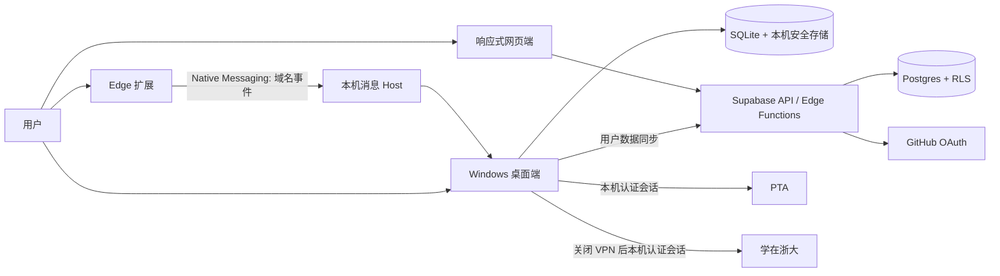

# 技术架构方案

版本：`0.1-draft`  
日期：`2026-07-06`  
状态：已批准

产品显示名：`Fuck DDL`  
技术 slug：`fuck-ddl`

## 1. 架构结论

采用本地优先、云端同步的多客户端架构：

- Windows：Tauri 2 + React + TypeScript，SQLite 本地数据库。
- 网页：React + TypeScript 响应式 SPA，共用领域、UI 和应用层。
- 云端：Supabase Auth + Postgres + Row Level Security + Edge Functions。
- 登录：Supabase GitHub OAuth，授权码 + PKCE；第一版白名单。
- Edge：Manifest V3 扩展 + Windows Native Messaging host。
- 外部来源：桌面端独立适配器读取 PTA 与学在浙大，云端不持有第三方会话。

选择理由：Tauri 提供 Windows 托盘、通知、深链接、开机启动和 SQLite 插件；Supabase 提供 GitHub 社交登录、Postgres 和 RLS，减少自建认证系统的安全风险。

## 2. 系统边界



第三方网站认证与云端账户认证严格分离。PTA/学在浙大的 Cookie 或令牌不能经过同步 API。

## 3. 计划目录结构

以下是用户批准后才创建的目标结构：

```text
.
├─ apps/
│  ├─ desktop/
│  │  ├─ src/                 # 桌面入口和平台适配
│  │  └─ src-tauri/           # Rust、权限、托盘、通知、SQLite
│  ├─ web/                    # 响应式网页入口与部署配置
│  ├─ edge-extension/         # Manifest V3、域名计时和设置页
│  └─ native-host/            # Edge Native Messaging 的小型 Rust host
├─ packages/
│  ├─ app-shell/              # 页面、路由和跨平台用例编排
│  ├─ ui/                     # 设计令牌和可访问组件
│  ├─ domain/                 # Task、Timer、排序和状态机
│  ├─ data-client/            # 云端 API 与平台存储接口
│  ├─ sync/                   # outbox、版本、合并和重试
│  ├─ integrations/           # 来源契约和脱敏测试样本
│  ├─ config/                 # 阈值、权重、同步频率
│  └─ test-fixtures/          # 跨端共享测试数据
├─ supabase/
│  ├─ migrations/             # Postgres 迁移与 RLS 策略
│  ├─ functions/              # 同步、白名单和审计函数
│  └─ seed.sql                # 仅本地开发数据
├─ docs/
│  ├─ PRODUCT_SPEC.md
│  ├─ UX_DESIGN.md
│  ├─ ARCHITECTURE.md
│  ├─ DELIVERY_PLAN.md
│  └─ OPERATIONS.md
├─ scripts/                   # 构建、校验、备份和发布脚本
├─ .github/workflows/         # 检查、构建和发布流水线
├─ codex.md
├─ README.md
├─ package.json
├─ pnpm-workspace.yaml
└─ turbo.json                 # 仅在验证确有收益后启用
```

## 4. 领域边界

### 4.1 核心实体

- `UserProfile`：云端用户、GitHub ID、白名单状态和偏好。
- `Goal`：长期目标、目标日期、状态和聚合进度。
- `Project`：手动项目或来源课程。
- `Task`：主任务、状态、DDL、进度、重要程度和来源。
- `Subtask`：子任务、权重和完成状态。
- `TimeEntry`：起止时间、任务、计时模式、是否补录。
- `FocusSession`：任务、预设、计划时长、实际时长、完成/中断状态和暂停片段。
- `BreakLedgerEntry`：休息额度的产生、正式休息/摸鱼消耗、余额和本地日期。
- `PomodoroPreset`：系统或用户预设、专注分钟、休息分钟和启用状态。
- `DistractionEntry`：仅本机保存的域名、开始/结束时间和对应专注，不含完整 URL。
- `DailyPlan`：日期、建议版本和用户确认后的时段。
- `IntegrationAccount`：只保存来源元数据；敏感会话不进入云端。
- `SyncCursor`：来源增量同步位置和最后成功时间。
- `TaskVersion`：冲突恢复和审计。
- `DomainVisit`：仅本机域名聚合，不含完整 URL。
- `CompletionRecord`：完成任务快照、来源、原 DDL、完成时间和完成原因。
- `GradeRecord`：独立保存来源、来源 ID、课程、分数/满分、排名、成绩状态和原 DDL；未公布分数必须为 `null`。
- `DailyWork`：本地自然日键和当日有效工作秒数。

### 4.2 状态机

持久化状态：`open | completed | abandoned`。  
派生状态：`normal | due_48h | due_24h | due_2h | overdue`。

`overdue` 不直接改写任务完成状态，避免过期等同于结束。外部任务状态由来源适配器更新。

计时状态：`idle | focusing | focus_paused | focus_complete | resting | distracted`。

- 任意时刻只能存在一个活动计时状态。
- 所有计时以开始时间和累计暂停时长计算，UI 秒数不是事实来源。
- 关闭程序时把活动段截断到关闭时刻并持久化，重新打开不自动恢复。
- `distracted` 从非白名单域名越过 10 分钟阈值后开始；此前 10 分钟仍属于专注。
- 休息额度使用追加式账本计算，允许负余额，每个本地自然日独立结算。
- 有效工作、完成率和完成列表均以用户本地自然日为边界；应用保持打开时也必须在 00:00 切日。
- 来源同步返回 `active/completed/expired` 任务快照和独立 `grades` 成绩快照。只有 `completed` 可以生成完成记录；缺失和失败快照只用于保留或移除活跃镜像，不得伪造完成。成绩按 `source + sourceId` 幂等合并，不随活跃任务删除。

## 5. 本地存储

- 使用 SQLite 保存完整可操作副本、outbox 和同步游标。
- 所有结构变化使用事务迁移；迁移失败必须回滚。
- SQLite 文件放在 Tauri 应用数据目录，不直接放入 OneDrive 同步目录。
- GitHub 会话令牌和第三方网站会话使用 Windows Credential Manager 或 Tauri Stronghold；实现阶段通过威胁建模二选一。
- 应用域名分类和访问片段默认只在本机保存。

## 6. 云端数据和隔离

- 每张用户数据表包含不可空的 `user_id`。
- 所有暴露表启用 RLS，并同时限制 `SELECT/INSERT/UPDATE/DELETE`。
- 客户端只使用 publishable key；service role 仅存在于受控 Edge Function 环境。
- 白名单基于 GitHub 不可变用户 ID，而不是用户名或邮箱。
- 白名单校验发生在首次账户创建钩子和应用层，拒绝后不创建业务资料。

## 7. GitHub 登录

网页端：

1. 跳转 Supabase GitHub provider。
2. 回调交换一次性 code。
3. 使用安全 Cookie 或受控存储维持会话。

桌面端：

1. 使用系统浏览器打开 GitHub 授权。
2. PKCE code verifier 保存在本机临时安全存储。
3. 回调通过自定义协议深链接返回已安装的 Tauri 应用。
4. Windows 深链接与单实例插件一起验证，防止启动第二个计时实例。

只请求识别用户所需的最小 GitHub 权限，不访问仓库。

## 8. 同步协议

- 客户端生成 UUID，写本地数据库与 outbox，再异步推送云端。
- 每次变更包含 `operation_id`，服务端保证幂等。
- 每条记录包含递增 `version` 和 `updated_at`。
- 拉取使用服务器游标，不以客户端时钟作为唯一依据。
- 非重叠字段修改自动合并；同字段冲突采用服务器接收顺序，并将旧值写入 `task_versions`。
- 外部来源字段具有更高权威级；本地备注、预计耗时和时间记录不被来源覆盖。
- 批量同步上限、退避和抖动集中配置。
- 来源适配器在应用启动、每 45 分钟、用户手动刷新和对应任务专注结束时触发；同一来源同时只允许一个请求。
- PTA 成绩扫描从活跃题目集进入所有题目集，排除仍活跃项后读取最多 100 个概览页；学在浙大只对已交、已截止或 DDL 已过的候选作业读取最多 24 个详情页。

## 9. 网站适配器

统一接口：

```text
connect() -> ConnectionState
validateSession() -> SessionState
fetchProjects(cursor) -> SourcePage<Project>
fetchTasks(projectId, cursor) -> SourcePage<Task>
fetchSubtasks(taskId, cursor) -> SourcePage<Subtask>
normalize(raw) -> CanonicalSourceRecord
```

每个适配器独立维护：

- 登录窗口和会话验证。
- API/DOM 解析策略。
- 脱敏 HTML/JSON 固定样本。
- 选择器/API 契约测试。
- 速率限制和错误翻译。

优先使用用户会话中的结构化网络接口；若无稳定接口才回退到 DOM 解析。两者都视为非公开契约，必须可快速停用。

## 10. Edge 扩展

- Manifest V3 权限最小化：`tabs`、`activeTab`、`nativeMessaging` 和必要存储。
- 只从活动标签页提取 `URL.hostname`，立即丢弃路径、查询和标题。
- 事件通过 Native Messaging 发往允许的本机 host。
- Host manifest 的 `allowed_origins` 只列正式扩展 ID。
- 桌面应用未运行时扩展本地排队少量事件，超限后丢弃而不是无限存储。
- Host 按域名和活动窗口累计连续停留时间；只有活动专注期间越过 10 分钟阈值才产生摸鱼事件。
- 白名单分为永久白名单和专注会话白名单，默认包含 `pintia.cn` 与 `courses.zju.edu.cn`。
- 扩展 Service Worker 只保存 `domain`、`startedAt` 和是否已触发阈值，休眠恢复后不会保存或重建完整 URL。
- Native Messaging Host 使用 4 字节小端长度帧，单条消息上限 64 KiB，只接受 `domain-threshold`、`domain-left` 和固定内容的 `bridge-ping`。握手事件不包含浏览域名。
- Host 从 `%LOCALAPPDATA%\com.fuckddl.desktop\edge-bridge.token` 读取随机令牌，再连接桌面端 `127.0.0.1:47831`；扩展进程不接触令牌。
- 桌面端拒绝错误令牌、非域名字符和未知事件类型；通过校验后才向 WebView 派发本地事件。

## 11. Windows 平台能力

- 系统托盘：当前任务、暂停、继续和打开应用。
- 全局快捷键：打开快速添加窗口；默认快捷键在实现阶段进行冲突检测。
- 通知：安装包中验证 Windows toast；开发模式的 PowerShell 名称不作为缺陷。
- 开机启动：用户显式开启，默认关闭。
- 自动更新：签名更新包，稳定通道和测试通道分离。
- 单实例：避免重复计时和深链接竞争。

## 12. 测试策略

- `domain`：排序公式、非线性时间条、状态机和计时切换的单元/性质测试。
- `sync`：离线、重复、乱序、冲突、重试和版本恢复。
- 数据库：迁移回滚、RLS 双用户隔离和软删除。
- UI：组件状态、键盘流程和可访问性。
- 桌面：Rust 单元测试 + 已安装应用冒烟测试。
- 扩展：域名脱敏和 Native Messaging 契约。
- 适配器：脱敏固定样本 + 用户实机会话验收。

## 13. 技术参考

- [Tauri SQL 插件与事务迁移](https://v2.tauri.app/plugin/sql/)
- [Tauri 通知插件](https://v2.tauri.app/plugin/notification/)
- [Tauri 深链接插件](https://v2.tauri.app/plugin/deep-linking/)
- [Tauri Stronghold 插件](https://v2.tauri.app/plugin/stronghold/)
- [Supabase GitHub 登录](https://supabase.com/docs/guides/auth/social-login/auth-github)
- [Supabase PKCE](https://supabase.com/docs/guides/auth/sessions/pkce-flow)
- [Supabase Row Level Security](https://supabase.com/docs/guides/database/postgres/row-level-security)
- [Supabase 数据安全](https://supabase.com/docs/guides/database/secure-data)
- [Microsoft Edge Native Messaging](https://learn.microsoft.com/en-us/microsoft-edge/extensions-chromium/developer-guide/native-messaging)
- [GitHub OAuth 应用](https://docs.github.com/en/apps/oauth-apps/building-oauth-apps)

## 14. P4 第一批落地记录（2026-07-24）

- Web 应用的持久化状态声明已集中到 `apps/web/src/app-persistence.js`，页面组件不再直接承担所有状态键、校验器和迁移器的组装。
- `apps/web/src/storage/sqlite-repository.js` 提供本地 repository 边界，统一状态读写、事务 schema、outbox 和同步游标访问。
- SQLite schema 新增 `schema_migrations`、`sync_outbox`、`sync_cursors`；本批次尚未接入云端上传，不改变第三方来源读取逻辑。
- 下一批治理重点是 outbox 的离线重放、退避重试、幂等确认、崩溃恢复和冲突策略，并为这些行为补充隔离测试。

## 15. P4 第二批 outbox 治理（2026-07-24）

- `apps/web/src/storage/outbox-policy.js` 集中定义指数退避、租约到期和过期判断，延迟上限为 15 分钟，默认租约为 30 秒。
- `sqlite-repository.js` 增加领取待处理项、成功确认、失败退回待重试和过期 `in-flight` 回收；领取条件包含 `available_at`，确认条件包含 operation id 与租约状态，避免重复确认覆盖新状态。
- 失败重试保留 payload 与版本，递增 attempts 并写入 `last_error`；失败状态可由上层显式标记，自动重试编排和最终失败策略仍待后续批次接入。
- 本批次使用纯函数策略测试和 SQLite 调用隔离测试覆盖 11/11；未接入云端、不改变 PTA/ZJU 任务或成绩读取逻辑。

## 16. P4 第三批离线重放与冲突边界（2026-07-24）

- `outbox-replay.js` 提供离线重放编排：领取带租约的 operation，向发送器传递稳定 `operationId`，发送失败进入退避重试，确认失败保留 `in-flight` 交给恢复流程处理。
- `sync-conflict-policy.js` 将同步状态分为本地变更、远端变更、无变化和同时变更；同时变更默认 `hold`，只有显式选择 `local-wins` 或 `remote-wins` 才允许应用一侧结果。
- 本批次只提供本地可测试的编排与决策边界，未接入网络 transport、云端写入或自动冲突覆盖；不改变 PTA/ZJU 任务与成绩读取。
- Web 回归测试现为 23 个测试文件、142/142。

## 17. P4 第四批租约栅栏与恢复门禁（2026-07-25）

- `operation_id` 现在作为不可变幂等键；重复入队使用 `ON CONFLICT DO NOTHING`，不会复活已发送或已终止的操作。
- 领取时的 `updated_at` 同时作为租约栅栏。成功确认、失败退避和终止失败都必须携带该栅栏；租约过期后旧发送者无法确认后来重新领取的记录。
- 崩溃回收直接比较每条记录的实际 `available_at`，不再用固定时长反推，支持不同租约时长。
- 桌面 SQLite 边界新增单飞 `replayDesktopOutbox`，并发触发共享同一次重放，避免同进程重复发送。
- 自动重试最多 8 次，随后进入 `failed`；重新提交必须生成新的 `operation_id`。
- `sqlite-repository.integration.test.js` 使用 Node 24 内置真实内存 SQLite 验证：租约到期、旧租约拒绝、确认崩溃后幂等重放、重复 id 不复活、终止失败不再领取。
- 本批不接云端、不改变 PTA/ZJU 任务或成绩读取。真实 transport 实现属于 P5，仍未授权。
